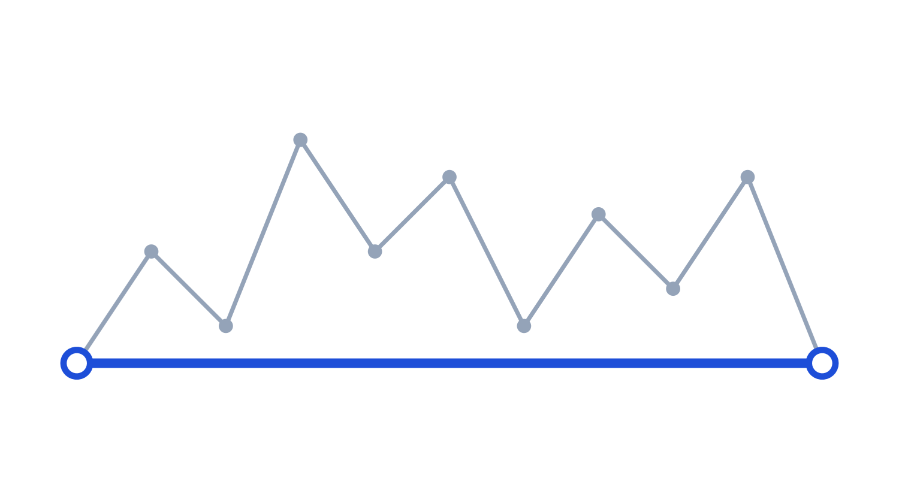
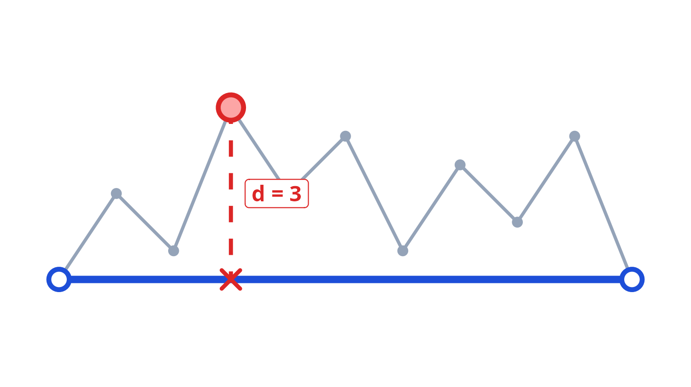
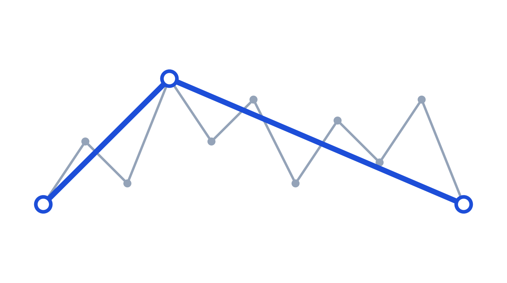
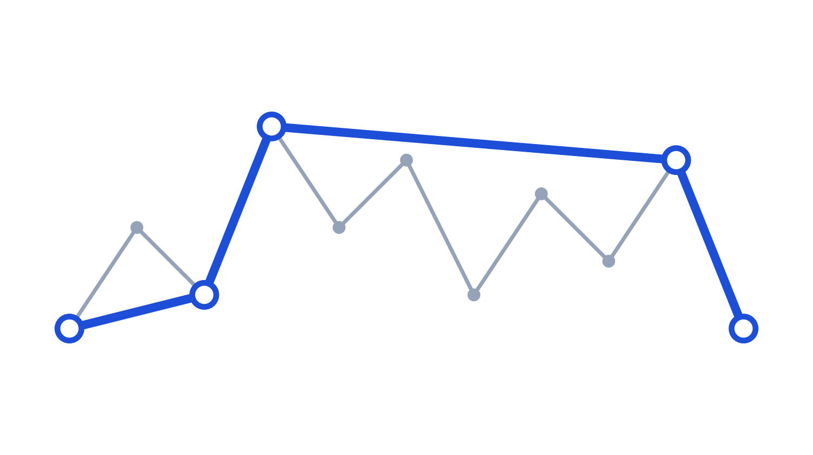
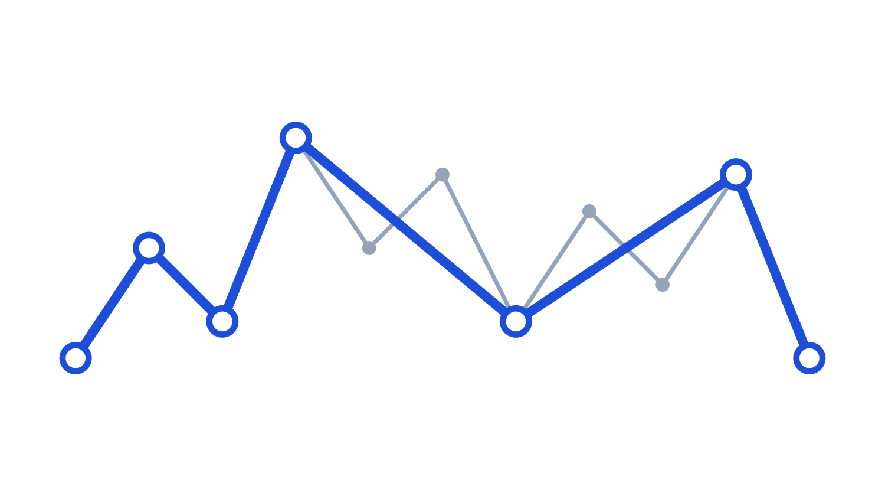

```{r}
#| echo: false
library(sf)
library(dplyr)
library(ggplot2)
library(patchwork)
```


## Today

1. **Centroids** — center of mass, and when it lies outside the polygon
2. **Affine transformations** — shift, scale, rotate with sf arithmetic
3. **Simplification** — Douglas-Peucker, topology problems, `ms_simplify()`
4. **Challenge** — design a line simplification algorithm

# Centroids {.subtitle}

## Center of mass

- `st_centroid()` returns the **center of mass** — the balance point of the shape
- Used for: distance calculations, representative points, labeling

```{r}
#| echo: false
luzern <- read_sf("data/Spatial_Analysis_II/swissBOUNDARIES3D.gpkg")
luzern_centroid <- st_centroid(luzern)
```

```{r}
#| echo: true
luzern_centroid <- st_centroid(luzern)
```

```{r}
#| echo: false
#| fig-height: 3.5
ggplot(luzern) +
  geom_sf(fill = "gray90", color = "gray50") +
  geom_sf(data = luzern_centroid, color = "firebrick", size = 3) +
  theme_void() +
  labs(title = "Centroid of Canton Luzern")
```

## 

- For **concave** or **C-shaped** geometries, the centroid can fall **outside** the polygon
- `st_point_on_surface()` always returns a point **inside**
- Typical uses:
  - `st_centroid()`: Distance metrics, spatial analytics
  -  `st_point_on_surface()`: Map labeling, feature sampling


```{r}
#| echo: false
#| fig-height: 3.5
u <- st_sfc(st_polygon(list(matrix(
  c(0,0, 4,0, 4,4, 3.5,4, 3.5,1, 0.5,1, 0.5,4, 0,4, 0,0),
  ncol = 2, byrow = TRUE
))))
u_centroid <- st_centroid(u)
u_pos      <- st_point_on_surface(u)
cx <- st_coordinates(u_centroid)
px <- st_coordinates(u_pos)

ggplot() +
  geom_sf(data = u, fill = "gray85", color = "gray40", linewidth = 0.8) +
  geom_sf(data = u_centroid, color = "firebrick", size = 4) +
  geom_sf(data = u_pos, color = "steelblue", size = 4, shape = 17) +
  annotate("label", x = cx[1] + 0.15, y = cx[2],
           label = "st_centroid()", color = "firebrick", hjust = 0, size = 3.5) +
  annotate("label", x = px[1] + 0.15, y = px[2],
           label = "st_point_on_surface()", color = "steelblue", hjust = 0, size = 3.5) +
  theme_void()
```


# Affine Transformations {.subtitle}

## Three elementary operations

- **Affine transformations** preserve lines and parallelism — angles and lengths may change
- In `sf`: applied directly to `sfc` objects using arithmetic operators

| Operation | sf syntax | Effect |
|---|---|---|
| Shift | `sfc + c(dx, dy)` | Move without changing shape |
| Scale | `(sfc - p) * factor + p` | Grow or shrink around a point `p` |
| Rotate | `(sfc - p) * R(θ) + center` | Rotate around a point `p` |

:::{.notes}
The pattern `(sfc - center) * operation + center` appears in both scale and rotate: subtract center to bring the geometry to the origin, apply the transformation, then shift back. This is the key insight students should take away.
:::

## Shift and Scale

```{r}
#| echo: false
luzern_sfc    <- st_zm(st_geometry(luzern))   # drop Z coords from 3D file
luzern_center <- st_centroid(luzern_sfc)
```

```{r}
#| echo: true
# Shift: move 10 km east
luzern_shifted <- luzern_sfc + c(10000, 0)

# Scale: shrink to 75% around centroid
luzern_scaled  <- (luzern_sfc - luzern_center) * 0.75 + luzern_center
```

```{r}
#| echo: false
#| fig-height: 3

st_crs(luzern_shifted) <- st_crs(luzern)
st_crs(luzern_scaled)  <- st_crs(luzern)

p1 <- ggplot() +
  geom_sf(data = luzern_sfc, fill = "gray80", color = "gray50", linetype = "dashed") +
  geom_sf(data = luzern_shifted, fill = NA, color = "red") +
  theme_void() + labs(title = "Shift: + c(10 000, 0)")

p2 <- ggplot() +
  geom_sf(data = luzern_sfc, fill = "gray80", color = "gray50", linetype = "dashed") +
  geom_sf(data = luzern_scaled, fill = NA, color = "red") +
  theme_void() + labs(title = "Scale: × 0.75 around centroid")

p1 + p2
```

## Rotation

- **Shift to origin → rotate → shift back** — otherwise the geometry rotates around (0, 0)
- $R(\theta) = \begin{bmatrix} \cos\theta & -\sin\theta \\ \sin\theta & \cos\theta \end{bmatrix}$


```{r}
#| echo: true
rotation <- function(deg) {
  r <- deg * pi / 180          # convert degrees to radians
  matrix(                      # 
    c(cos(r), -sin(r),          #   [ cos(r), -sin(r) ]
     sin(r), cos(r)),           #   [ sin(r),  cos(r) ]
    nrow = 2, ncol = 2, byrow = TRUE
  )
}
```

---

```{r}
#| echo: true
#| 
luzern_rotated <- (luzern_sfc - luzern_center) * rotation(15) + luzern_center
```

```{r}
#| echo: false
st_crs(luzern_rotated) <- st_crs(luzern)

ggplot() +
  geom_sf(data = luzern_sfc, fill = "gray80", color = "gray50", linetype = "dashed") +
  geom_sf(data = luzern_rotated, color = "red", fill = NA) +
  theme_void() + labs(title = "Rotation: 15° around centroid")
```

---

The same pattern applies to all three operations — only the transformation differs:

```{r}
#| eval: false
(sfc - center) + center          # identity (no-op)
(sfc - center) * 0.5 + center    # scale
(sfc - center) * rotation(45) + center  # rotate
```

Transformations **compose**: shift first, then scale, then rotate gives a different result than the reverse order.

# Simplification {.subtitle}

## Why simplify?

- Real datasets carry more vertices than any display scale needs
- Excess vertices: slow rendering, large files, no visual benefit

```{r}
#| echo: false
#| fig-height: 3.5
luzern_500  <- st_simplify(luzern, dTolerance = 500,  preserveTopology = TRUE)
luzern_5000 <- st_simplify(luzern, dTolerance = 5000, preserveTopology = TRUE)

n0 <- nrow(st_coordinates(luzern))
n1 <- nrow(st_coordinates(luzern_500))
n2 <- nrow(st_coordinates(luzern_5000))

p0 <- ggplot(luzern)      + geom_sf(fill = "gray85") + theme_void() +
  labs(title = "Original",   subtitle = paste(n0, "vertices"))
p1 <- ggplot(luzern_500)  + geom_sf(fill = "gray85") + theme_void() +
  labs(title = "500 m",      subtitle = paste(n1, "vertices"))
p2 <- ggplot(luzern_5000) + geom_sf(fill = "gray85") + theme_void() +
  labs(title = "5 000 m",    subtitle = paste(n2, "vertices"))

p0 + p1 + p2
```


## Challenge: Line simplification Algorithm

<span class="timer" data-minutes="10"></span>

- **Given:** a polyline V₁, V₂, ..., Vₙ 
- **Task:** develop an algorithm that removes "unnecessary" vertices — those that add no meaningful shape information at scale ε


:::{.callout-important title="Closed book!"}
Do not use any external sources. Solve with your own ideas in groups
:::


## Douglas-Peucker

- `st_simplify()` uses the **Douglas-Peucker** algorithm
- Core idea: a point is **unnecessary** if it lies close to the line between its neighbours
- Tolerance ε controls how much deviation is acceptable

:::{.r-stack}
{.fragment .fade-in-then-out width="80%"}

{.fragment .fade-in-then-out width="80%"}

{.fragment .fade-in-then-out width="80%"}

{.fragment .fade-in-then-out width="80%"}

{.fragment .fade-in-then-out width="80%"}
:::

## The topology problem

- `st_simplify()` processes each feature **independently**
- Shared boundaries are simplified separately → **gaps and overlaps** appear

```{r}
#| echo: false
library(rnaturalearth)

neighbors <- ne_countries(continent = "Europe", returnclass = "sf") |>
  filter(name %in% c("Switzerland", "Germany", "France", "Austria", "Italy")) |>
  st_transform(3857) |>
  select(name) |> 
  st_cast("POLYGON")

neighbors$area <- as.numeric(st_area(neighbors))

neighbors <- neighbors |> 
  group_by(name) |> 
  top_n(1, area)

n_simp <- st_simplify(neighbors, dTolerance = 100000)

p_orig <- ggplot(neighbors) + geom_sf(aes(fill = name), show.legend = FALSE) +
  theme_void() + labs(title = "Original")
p_simp <- ggplot(n_simp)    + geom_sf(aes(fill = name), show.legend = FALSE) +
  theme_void() + labs(title = "st_simplify — per feature")

p_orig + p_simp
```

## Topology-preserving simplification

- `rmapshaper::ms_simplify()` simplifies the **whole layer at once** — shared boundaries stay consistent
- Uses the **Visvalingam** algorithm: iteratively removes the vertex that creates the smallest triangle area


```{r}
#| echo: true
library(rmapshaper)
# We specify the proportion of points to keep
n_ms <- ms_simplify(neighbors, keep = 0.5)
```

---


```{r}
#| echo: false
p1 <- ggplot(neighbors) + geom_sf(aes(fill = name), show.legend = FALSE) +
  theme_void() + labs(title = "Original")
p2 <- ggplot(n_simp)    + geom_sf(aes(fill = name), show.legend = FALSE) +
  theme_void() + labs(title = "st_simplify", subtitle = "gaps visible")
p3 <- ggplot(n_ms)      + geom_sf(aes(fill = name), show.legend = FALSE) +
  theme_void() + labs(title = "ms_simplify", subtitle = "topology preserved")

p1 + p2 + p3
```

## Summary

- **`st_centroid()`** returns the geometric centre of mass — useful for distance calculations and analytics, but it can fall *outside* the shape for concave or C-shaped geometries. Use **`st_point_on_surface()`** when you need a point guaranteed to lie inside.

- **Affine transformations** (shift, scale, rotate) preserve shape and angles. All three follow the same pattern in sf: shift to the origin, apply the transformation, shift back. sf lets you do this with ordinary arithmetic directly on `sfc` objects. Transformations are not commutative — order matters.

- **`st_simplify()`** reduces vertex count using the Douglas-Peucker algorithm: it recursively removes vertices that deviate less than tolerance ε from the local baseline. It operates feature by feature, so shared boundaries between adjacent polygons can develop gaps and overlaps.

- **`ms_simplify()`** (rmapshaper) uses the Visvalingam algorithm and processes the entire layer at once, keeping shared edges consistent. Prefer it whenever topology matters.
