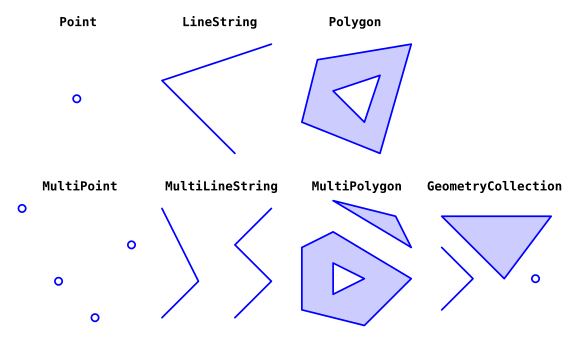
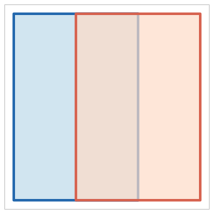
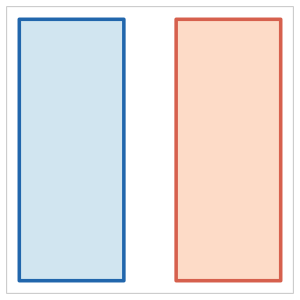
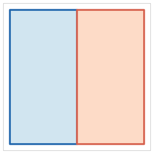
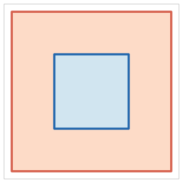
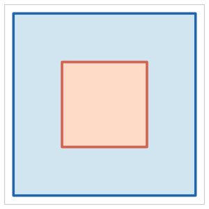
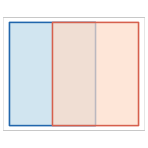
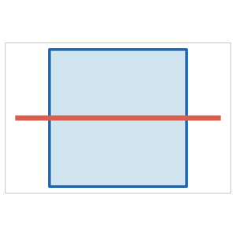

```{r}
#| echo: false
library(sf)
library(dplyr)
library(ggplot2)
```

```{r}
#| echo: false
#| include: false
dir.create("images/predicates", showWarnings = FALSE, recursive = TRUE)

col_a <- "#2166ac"; col_b <- "#d6604d"
fill_a <- "#d1e5f0"; fill_b <- "#fddbc7"

dt_sm <- theme_void() + theme(
  plot.background  = element_rect(fill = "white", color = NA),
  panel.background = element_rect(fill = "white", color = "gray75", linewidth = 0.4),
  plot.margin = margin(3, 3, 3, 3)
)

mp <- function(x1, y1, x2, y2)
  st_sfc(st_polygon(list(matrix(c(x1,y1,x2,y1,x2,y2,x1,y2,x1,y1), ncol=2, byrow=TRUE))))

sv <- function(p, name)
  ggsave(paste0("images/predicates/", name, ".png"), p, width=2.0, height=2.0, dpi=150, bg="white")

# intersects — any overlap (partial)
pA <- mp(0,0,2,3); pB <- mp(1,0,3,3)
sv(ggplot() + geom_sf(data=pA, fill=fill_a, color=col_a, linewidth=0.8) +
   geom_sf(data=pB, fill=fill_b, color=col_b, linewidth=0.8, alpha=0.7) + dt_sm, "intersects")

# disjoint — no overlap
pA <- mp(0,0,1.2,3); pB <- mp(1.8,0,3,3)
sv(ggplot() + geom_sf(data=pA, fill=fill_a, color=col_a, linewidth=0.8) +
   geom_sf(data=pB, fill=fill_b, color=col_b, linewidth=0.8) + dt_sm, "disjoint")

# touches — shared edge only
pA <- mp(0,0,1.5,3); pB <- mp(1.5,0,3,3)
sv(ggplot() + geom_sf(data=pA, fill=fill_a, color=col_a, linewidth=0.8) +
   geom_sf(data=pB, fill=fill_b, color=col_b, linewidth=0.8) + dt_sm, "touches")

# within — A (blue, small) inside B (red, large)
pB <- mp(0,0,3,3); pA <- mp(0.8,0.8,2.2,2.2)
sv(ggplot() + geom_sf(data=pB, fill=fill_b, color=col_b, linewidth=0.8) +
   geom_sf(data=pA, fill=fill_a, color=col_a, linewidth=0.8) + dt_sm, "within")

# contains — A (blue, large) contains B (red, small)
pA <- mp(0,0,3,3); pB <- mp(0.8,0.8,2.2,2.2)
sv(ggplot() + geom_sf(data=pA, fill=fill_a, color=col_a, linewidth=0.8) +
   geom_sf(data=pB, fill=fill_b, color=col_b, linewidth=0.8) + dt_sm, "contains")

# overlaps — partial overlap, same type
pA <- mp(0,0.3,2,2.7); pB <- mp(1,0.3,3,2.7)
sv(ggplot() + geom_sf(data=pA, fill=fill_a, color=col_a, linewidth=0.8) +
   geom_sf(data=pB, fill=fill_b, color=col_b, linewidth=0.8, alpha=0.7) + dt_sm, "overlaps")

# crosses — line B crossing polygon A
pA <- mp(0.5,0.5,2.5,2.5)
ln <- st_sfc(st_linestring(matrix(c(0,1.5,3,1.5), ncol=2, byrow=TRUE)))
sv(ggplot() + geom_sf(data=pA, fill=fill_a, color=col_a, linewidth=0.8) +
   geom_sf(data=ln, color=col_b, linewidth=1.5) + dt_sm, "crosses")
```


:::: {.columns}

::: {.column width="60%"}
{style="border-radius: 100%; width: 50%;"}
:::

::: {.column width="40%"}


ZHAW School of Life Sciences and Facility Management
Institute of Natural Resource Sciences
Grüentalstrasse 14, 8820 Wädenswil

+41 (0) 58 934 55 63
nils.ratnaweera@zhaw.ch


Research Associate at the Research Group for Geoinformatics
[www.zhaw.ch/iunr/geoinformatik](http://www.zhaw.ch/iunr/geoinformatik)
:::

::::

## Today

1. **Simple Features** — the standard behind all vector GIS tools
2. **Coordinate Reference Systems** — datums, projections, units, silent errors
3. **GDAL & file formats** — the common backbone, format trade-offs
4. **Binary Predicates** — spatial relationships and choosing the right one
5. **Geometry Operations** — set algebra, type changes
6. **Group Work** — two algorithmic challenges

# Simple Features {.subtitle}

## Why a standard?

- Vector data is used in PostGIS, QGIS, R, Python, ArcGIS, GDAL, ...
- **Simple Features** (ISO 19125-1:2004) is the OGC standard all major spatial tools implement
- It defines: geometry types, encoding, and spatial relationships

## What is a feature?

> A simple feature is defined [...] to have both spatial and non-spatial attributes. Spatial attributes are geometry valued, and simple features are based on 2D geometry with linear interpolation between vertices.

— ISO 19125

---

- A **feature** is a real-world object: a building, a road, a lake
- Every feature has:
  1. A **geometry** — location and shape on Earth
  2. **Attributes** — everything else (name, population, category, ...)
- The geometry has a **type** and must satisfy **validity rules**

## Geometry types

- 18 types defined in the standard; 7 cover the vast majority of real-world data:

```{r}
#| echo: false
#| tbl-cap: "Source: @pebesma2018"
#| label: tbl-sf

library(kableExtra)

tibble::tibble(
  type = c(
    "`POINT`",
    "`LINESTRING`",
    "`POLYGON`",
    "`MULTIPOINT`",
    "`MULTILINESTRING`",
    "`MULTIPOLYGON`",
    "`GEOMETRYCOLLECTION`"
  ),
  desc = c(
    "zero-dimensional geometry containing a single point",
    "sequence of points connected by straight, non-self-intersecting line pieces",
    "sequence of points forming a closed, non-self-intersecting ring (with optional holes)",
    "set of points",
    "set of linestrings",
    "set of polygons",
    "set of geometries of any of the above types"
  ),
  dim = c(0, 1, 2, 0, 1, 2, NA)
) |>
  kable(col.names = c("Type", "Description", "Dimensions"))
```

---

:::{#fig-sf}



Image source: @dorman2023
:::

---

- All types are composed of **points** (0D), **lines** (1D), or **areas** (2D)
- Composite types arise naturally: a country with islands → `MULTIPOLYGON`, a branching river → `MULTILINESTRING`
- Every type has **validity rules** — violations cause silent errors or failed operations

---

| Violation | Description |
|---|---|
| Self-intersecting ring | A polygon whose boundary crosses itself (figure-8 shape) |
| Unclosed ring | Polygon exterior ring does not start and end at the same point |
| Hole outside exterior | A polygon hole lies outside or only partially inside the exterior ring |
| Duplicate points | Consecutive identical vertices in a ring |
| Wrong winding order | Exterior ring must be CCW; holes must be CW (OGC/ISO rule) |

- `st_is_valid()` checks; `st_make_valid()` attempts to fix
- Winding order is **not** checked by GEOS — violations pass validation but can break ESRI format interchange (Shapefiles use the opposite convention: exterior CW)

# Coordinate Reference Systems {.subtitle}

## The Earth is not flat

- The Earth is approximated as an **ellipsoid**: slightly flattened at the poles, bulging at the equator
- A **datum** defines which ellipsoid to use and how to orient it:
  - **WGS84** — global datum, used by GPS and internet maps
  - **CH1903+ / LV95** — Swiss national datum, optimized for Switzerland
- The same point has different coordinates in different datums

## Projections

- A **projection** transforms 3D ellipsoid coordinates onto a flat 2D plane
- Every projection distorts at least one property — **there is no undistorted flat map**:
  - **Equal-area** — preserves area; distorts shape and angles
  - **Conformal** — preserves local shape / angles; distorts area
  - **Equidistant** — preserves distance from a point; distorts area and shape

- National systems (e.g. LV95 / EPSG:2056) are conformal, minimizing distortion locally

## EPSG codes

- **EPSG codes** are the standard identifiers for coordinate reference systems:

| EPSG | Name | Unit | Typical use |
|---|---|---|---|
| 4326 | WGS84 | degree | GPS, global data, GeoJSON default |
| 2056 | CH1903+ / LV95 | meter | Swiss national datasets |
| 3857 | Web Mercator | meter | Web map tiles (Google, OSM) |
| 25832 | ETRS89 / UTM Zone 32N | meter | Central Europe |

## CRS in practice: the silent error

- Measurement operations (distance, area, buffer) use the CRS unit
- EPSG:4326 unit is **degrees** — `st_buffer(x, 1000)` means 1000 degrees, not meters

```{r}
#| echo: true
zh <- st_sfc(st_point(c(8.54, 47.38)), crs = 4326)
st_crs(zh)$ud_unit       
```

<https://www.google.com/maps/place/8°32'24.0"N+47°22'48.0"E/@8.54,47.3774197,10z>

---

```{r}
zh_lv95 <- st_transform(zh, 2056)
st_crs(zh_lv95)$ud_unit

zh_lv95
```

- Always check CRS before measurement; transform if needed
- **Axis order trap:** everyday usage is **lat, lon** (47.38, 8.54); sf / EPSG:4326 expects **(x, y) = lon, lat** (8.54, 47.38) 

# GDAL and the Vector Ecosystem {.subtitle}

## GDAL: one library, many tools

- [GDAL](https://gdal.org) (Geospatial Data Abstraction Library) underlies almost all GIS software:
  - QGIS, ArcGIS, GRASS, SAGA, FME, ...
  - R (`sf`)
  - Python (`geopandas`)
  - PostGIS

```{r}
#| echo: true
# sf delegates format detection to GDAL — driver chosen from file extension
stationen <- read_sf("data/uebung1/stationen_schweiz.geojson")   # → GeoJSON driver
hoheitsgebiet <- read_sf("data/Spatial_Analysis_I/Hoheitsgebiet/HOHEITSGEBIET_FR.shp")  # → Shapefile driver
```

- GDAL supports [80+ vector formats](https://gdal.org/en/latest/drivers/vector/index.html); `sf` inherits all of them

## Vector file formats

| Format | Extension | Strengths | Limitations |
|---|---|---|---|
| Shapefile | `.shp` (+ 4 files) | Universal legacy support | 10-char field names; 2 GB limit; no nulls |
| GeoJSON | `.geojson` | Human-readable; single file; web-native | Large files; no spatial index |
| GeoPackage | `.gpkg` | Modern; single file; multiple layers; SQLite inside | Less universal than Shapefile |
| PostGIS | (database) | Live DB; concurrent access; fast spatial index | Requires a server |
| FlatGeobuf | `.fgb` | Very fast; streamable; built-in spatial index | Newer, less tool support |
| DuckDB | `.duckdb` | Columnar analytics; spatial extension; queries remote files | Not a traditional GIS format |


# Binary Predicates {.subtitle}

## Spatial relationships as questions

- Binary predicates return TRUE/FALSE for a pair of geometries
- The question determines the correct predicate:
  - *Is this building inside the flood zone?* → `st_within(building, zone)`
  - *Does this road cross the zone?* → `st_crosses(road, zone)`
  - *Does any part of this forest touch Luzern?* → `st_intersects(forest, luzern)`
- The same pair can satisfy multiple predicates — wrong choice gives **silently wrong results**

## Named predicates

| Predicate | | When TRUE | Typical use case |
|---|:---:|---|---|
| `intersects` | {width=130px} | Any overlap exists (broadest) | Initial spatial filter |
| `disjoint` | {width=130px} | No overlap whatsoever | Exclusion / NOT queries |
| `touches` | {width=130px} | Boundaries meet; interiors do not | Adjacent parcels, shared borders |
| `within` | {width=130px} | All of A is inside B | Point-in-polygon, containment |

---

| Predicate | | When TRUE | Typical use case |
|---|:---:|---|---|
| `contains` | {width=130px} | All of B is inside A | Inverse of `within` |
| `overlaps` | {width=130px} | Interiors intersect; neither contains the other | Partial overlap of same-type features |
| `crosses` | {width=130px} | Interior of A intersects interior of B in lower dimension | Road through a zone |

- `intersects` is almost always TRUE for non-trivial pairs — rarely the right predicate for a precise question

## Choosing the right predicate

```{r}
#| echo: false
tlm3d_path <- "data/Spatial_Analysis_II/swiss_TLM3D.gpkg"
luzern <- read_sf("data/Spatial_Analysis_II/swissBOUNDARIES3D.gpkg")
tlm_wald <- read_sf(tlm3d_path, "tlm_bb") |>
  filter(objektart == "Wald") |>
  st_set_crs(2056)
```

```{r}
#| echo: true
# intersects: any part of the forest touches Luzern (including tiny overlap at the border)
wald_intersects <- st_filter(tlm_wald, luzern, .predicate = st_intersects)

# within: the *entire* forest polygon lies inside Luzern
wald_within <- st_filter(tlm_wald, luzern, .predicate = st_within)

nrow(wald_intersects)  # more: includes forests that merely touch the border
nrow(wald_within)      # fewer: only forests completely inside
```

---

```{r}
#| echo: false
#| label: fig-predicates
#| fig-cap: "`st_intersects` (left) vs `st_within` (right) — same data, different predicate, different question answered"
#| layout-ncol: 2

ggplot(luzern) +
  geom_sf(fill = "gray90") +
  geom_sf(data = wald_intersects, fill = "darkgreen", color = NA) +
  labs(title = "st_intersects") +
  theme_minimal() +
  theme(axis.text = element_blank(), axis.ticks = element_blank())

ggplot(luzern) +
  geom_sf(fill = "gray90") +
  geom_sf(data = wald_within, fill = "darkgreen", color = NA) +
  labs(title = "st_within") +
  theme_minimal() +
  theme(axis.text = element_blank(), axis.ticks = element_blank())
```

# Geometry Operations {.subtitle}

## Unary operations

- Take one geometry, return a (possibly different type of) geometry:

| Operation | What it does | Output type |
|---|---|---|
| `st_buffer(x, dist)` | Expand by distance | Polygon |
| `st_centroid(x)` | Center point | Point |
| `st_simplify(x, tol)` | Reduce vertex count | Same type |
| `st_convex_hull(x)` | Smallest convex polygon enclosing the geometry | Polygon |
| `st_boundary(x)` | The boundary of the geometry | Lower dimension |

## Binary set operations

- Set algebra on geometries — same logic as SQL set operations:

| Operation | Returns | Set notation |
|---|---|---|
| `st_intersection(A, B)` | Parts where A and B overlap | A ∩ B |
| `st_union(A, B)` | All of A and B, merged | A ∪ B |
| `st_difference(A, B)` | Parts of A outside B | A \ B |
| `st_sym_difference(A, B)` | Parts of A or B, but not both | A △ B |

- `st_union()` on a **single layer**: dissolve / aggregate — analogous to `GROUP BY` in SQL

## Operations can change geometry type

- Output type depends on the geometry relationship, not just the operation
- Intersecting two polygons can yield a polygon, a line, or a point:
  - Overlapping → **polygon**; 
  - sharing only an edge → **line**; 
  - sharing only a corner → **point**
- Code expecting a polygon **fails silently** if inputs only touch

---

```{r}
#| echo: true
wald_clipped <- st_intersection(luzern, tlm_wald)

# Fraction of Luzern covered by forest
sum(st_area(wald_clipped)) / st_area(luzern)
```

```{r}
#| echo: false
ggplot(luzern) +
  geom_sf(fill = "gray90") +
  geom_sf(data = wald_clipped, fill = "darkgreen", color = NA) +
  theme_minimal() +
  theme(axis.text = element_blank(), axis.ticks = element_blank()) +
  labs(title = "Forest clipped to canton boundary (st_intersection)")
```

<!-- todo: buffer and dissolve examples -->


# Group Work

## Write an algorithm

How do you make a Peanutbutter & Jelly Sandwitch (PB&J)


## {background-iframe="https://www.youtube.com/embed/FN2RM-CHkuI?si=u-FJbPsDpu4vIXYL" backgrond-interactive=false}


## Challenge 1: Bounding box of a point stream

- A continuous stream of 2D coordinates arrives one point at a time.
- **Task:** develop an algorithm for the smallest axis-aligned bounding box of all points received so far.
- **Constraints**: process each point once; do not store the full list; update the box on each new point.
- Example stream:
  ```
  2489750, 1117500
  2506250, 1172500
  2552750, 1223500  ...
  ```

:::{.callout-important title="Closed book!"}
Do not use any external sources. Solve with your own ideas in groups
:::


## Challenge 2: Is a point inside a polygon?

- **Given:** an ordered sequence of 2D polygon vertices and a point with known coordinates.
- **Task:** develop an algorithm that determines whether the point is inside or outside the polygon.
- Constraints: use only the vertex coordinates; no visual inspection; must work for arbitrary simple polygons.

:::{.callout-important title="Closed book!"}
Do not use any external sources. Solve with your own ideas in groups
:::


## References {#refs}
